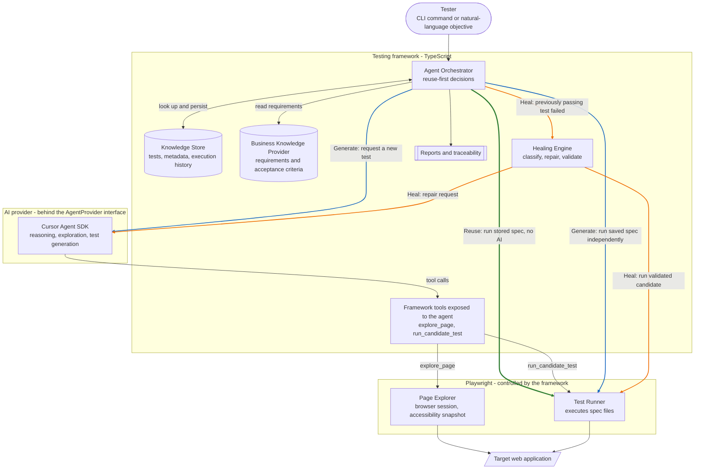
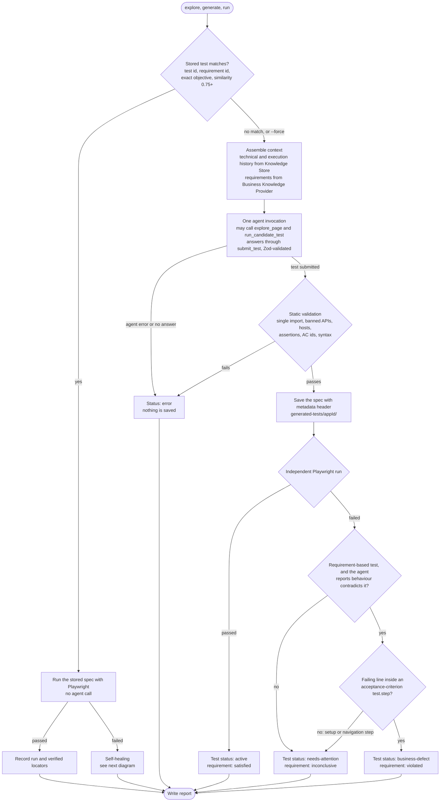
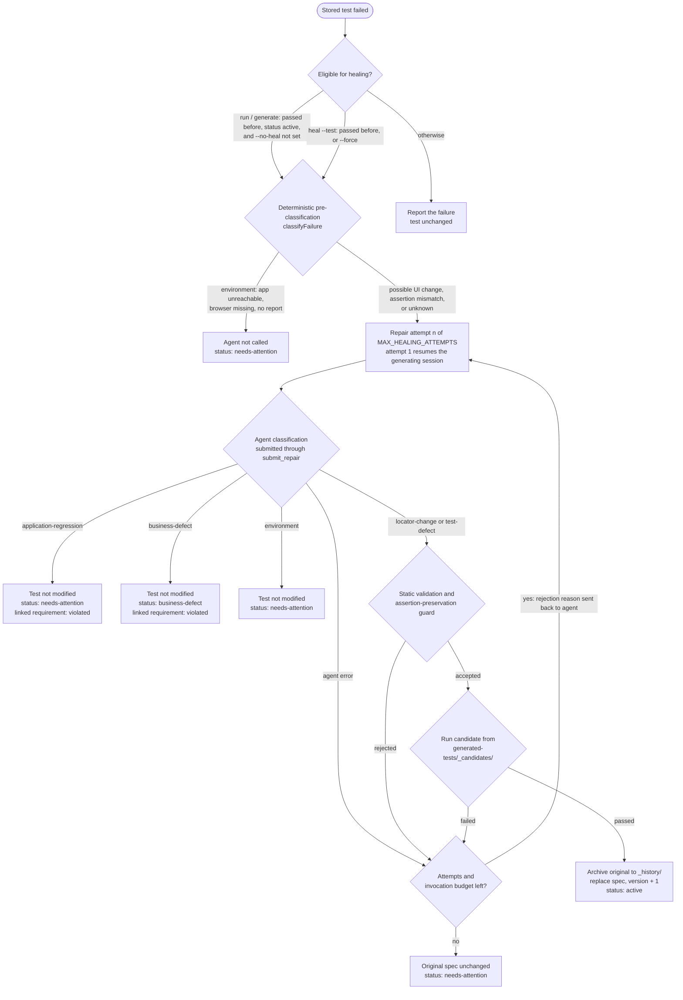
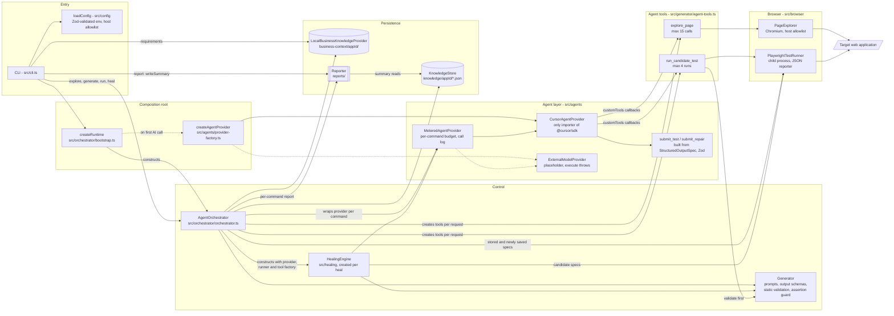

# Architecture

## Architecture overview

The framework turns a natural-language objective (or a business requirement id) into a stored, versioned Playwright test,
re-executes that test without AI on every later request, and uses an AI agent again only to generate a missing test or to
repair a previously passing test that broke.

Every command follows one of three paths:

| Path | When | AI used |
|---|---|---|
| **Reuse** | A stored test matches the request. | No. Playwright runs the stored spec. |
| **Generate** | No stored test matches (or `--force`). | One agent invocation explores the app and submits a test; the framework validates and runs it. |
| **Heal** | A test that passed before now fails, and the failure is not an environment problem. | Up to `MAX_HEALING_ATTEMPTS` repair invocations; every candidate is validated and run by the framework. |

The agent never drives the browser itself. It can only call framework-implemented tools (`explore_page`,
`run_candidate_test`) and submit a structured answer. The framework, not the agent, decides what is saved and what counts as
the result.

## High-level architecture diagram

How to read it:

- **Reuse (green)**: the orchestrator finds a stored test in the Knowledge Store and asks the Test Runner to execute it.
  No agent is created.
- **Generate (blue)**: the orchestrator sends one request to the agent with technical context from the Knowledge Store and,
  when relevant, requirements from the Business Knowledge Provider. While working, the agent can call the two framework
  tools (grey arrows). When it submits a test, the framework validates and saves it, then runs it independently. The
  agent's own candidate runs are not the result.
- **Heal (orange)**: when a previously passing test fails, the Healing Engine asks the agent for a repair through the same
  tools, then validates the candidate and runs it with the Test Runner before replacing anything.
- Every agent request goes through a metered provider that enforces a per-command invocation budget (see
  [Detailed component architecture](#detailed-component-architecture)).

## Key architectural decisions

Each decision states what is **implemented** today, **why** it was chosen, and, where relevant, what is **future** work.

### 1. AI reasoning is separated from Playwright execution

- **Implemented**: the agent has no shell or file-system tools (`tools: ['mcp']`). It reaches the browser only through
  `explore_page` (bounded exploration via `PageExplorer`) and `run_candidate_test` (static validation, then
  `PlaywrightTestRunner`). The final result always comes from a separate run started by the orchestrator or Healing Engine.
- **Why**: test outcomes must be reproducible and auditable. A Playwright run of a stored file is deterministic. A
  model's statement that it ran something is not. Bounding the tools also limits what an agent can do to the environment.

### 2. The orchestrator is reuse-first

- **Implemented**: before any AI call, `findReusableTest` looks up a stored test by test id, requirement id, normalised
  objective, or objective similarity of at least 0.75. A match is executed directly and recorded with `aiInvocations: 0`.
- **Why**: once a test exists, repeated runs should cost no tokens, finish at Playwright speed, and give the same result
  on the same application. AI is reserved for the steps that need reasoning: creating a missing test or repairing a
  broken one.

### 3. Knowledge is persisted between executions

- **Implemented**: per-app JSON files under `knowledge/<appId>/` hold tests, execution and healing history, agent session
  metadata, verified locators, page observations and requirement traceability. Generated specs are versioned under
  `generated-tests/`, with history in `_history/`.
- **Why**: persistence is what makes reuse possible. It also gives later prompts the verified locators and run history,
  lets healing resume the generating agent session, and gives an audit trail of what changed and why.

### 4. Self-healing is restricted and validated

- **Implemented**: only previously passing tests are eligible. Environment failures never reach the agent. Only
  `locator-change` and `test-defect` classifications may change a test. Each candidate must pass static validation,
  the assertion-preservation guard, and a real Playwright run before it replaces the original. The original is archived
  first.
- **Why**: an unrestricted healer can make a failing test pass by weakening it, which would hide real regressions. The
  restrictions make sure healing only adapts how the test finds elements, never what it checks.

### 5. The agent provider is abstracted from orchestration

- **Implemented**: the orchestrator and Healing Engine depend only on the provider-neutral `AgentProvider` contract in
  `src/agents/agent-provider.ts`. `CursorAgentProvider` is the only file that imports `@cursor/sdk`. Integration tests
  substitute a scripted provider (`tests/helpers/scripted-provider.ts`) through the same contract.
- **Why**: the model vendor is the part most likely to change. Keeping SDK types out of orchestration means
  generation, healing and reporting logic do not depend on one vendor's API. See
  [Agent providers and future model integration](#agent-providers-and-future-model-integration).

### 6. A lightweight TypeScript orchestrator instead of an orchestration framework

- **Implemented**: `AgentOrchestrator` is plain TypeScript. It runs a short, sequential control flow (lookup, generate
  or run, optionally heal, report) in a single process, with explicit limits for attempts, invocations and timeouts.
- **Why**: the flow is small, deterministic and mostly not AI-driven. Explicit code keeps every branch visible, testable
  with Vitest and debuggable without an extra runtime or dependency. The agent's own multi-step reasoning is handled
  inside the SDK.
- **Future**: if the flow grows to parallel agents, long-running or resumable workflows, or human approval steps, a
  dedicated orchestration framework could be evaluated. The `AgentProvider` and `BusinessKnowledgeProvider` interfaces
  would remain the integration points.

## Request lifecycle

### Lookup, generation and execution

Applies to `explore`, `generate` and `run`. A `run` request with an objective or requirement that matches no stored test
falls back to generation. A `run --test <id>` with an unknown id stops with an error.

A newly generated test that fails is never healed in the same command because it has never passed.

### Self-healing

The assertion-preservation guard rejects a candidate if any original `expect` matcher is missing (negated matchers
included), the number of `expect()` calls drops, or an acceptance-criterion id is removed. Candidates are written only to
`_candidates/`, so the original file changes only when a candidate has passed.

## Detailed component architecture

For developers. Solid arrows are direct calls or construction. Dotted arrows are lazy creation or the not-implemented
provider. `bootstrap.ts` is the composition root: the only place where concrete classes are wired together. The
orchestrator receives them as interfaces.

Notes on the edges:

- `PageExplorer` is held by the orchestrator only so it can build the `explore_page` tool. The orchestrator never
  explores pages itself.
- `HealingEngine` does not write to the Knowledge Store. It reports each attempt through an `onAttempt` callback, and
  the orchestrator persists the record and updates the test.
- The provider is created lazily. A command that only reuses passing tests never constructs it and needs no API key.
- The `models` CLI command calls `listCursorModels` in `cursor-provider.ts` directly; `doctor` only reads config and
  checks that the target URL responds.

### Layers and boundaries

| Layer | Location | Responsibility |
|---|---|---|
| Configuration | `src/config` | Zod-validated `.env` + process env, host allowlist, application profiles (`app-profiles/*.json`), key redaction. |
| Agent abstraction | `src/agents/agent-provider.ts` | Provider-neutral request/result types (`AgentRequest`, `AgentResult`, `AgentTool`, `StructuredOutputSpec`) and `MeteredAgentProvider`. No SDK types leak out. |
| Cursor provider | `src/agents/cursor-provider.ts` | The only file that imports `@cursor/sdk`. Creates/resumes local agents, maps tools to `customTools`, adds the structured-output tool, enforces timeout and retries, maps usage. |
| External provider | `src/agents/external-model-provider.ts` | Prepared seam, deliberately not implemented (`execute` throws `ExternalModelProviderNotConfigured`). |
| Orchestrator | `src/orchestrator` | Reuse-first control flow, persistence, traceability, report assembly. Depends only on interfaces; `bootstrap.ts` wires the concrete classes. |
| Browser | `src/browser` | `PageExplorer` (bounded exploration, accessibility snapshots), `PlaywrightTestRunner` (spawns Playwright Test, normalises JSON report), URL allowlist. |
| Generation | `src/generator` | Prompt sections, output schemas, agent tools, static validation of generated code, assertion-preservation guard. |
| Healing | `src/healing` | Failure pre-classification, bounded repair loop, candidate verification, archive/rollback. |
| Knowledge | `src/knowledge` | Per-app JSON store (`knowledge/<appId>/*.json`), deterministic test matching. |
| Business knowledge | `src/business-knowledge` | `BusinessKnowledgeProvider` interface + local JSON/Markdown implementation (`business-context/<appId>/`). |
| Reporting | `src/reporting` | Per-command JSON + Markdown reports and an aggregated summary (`reports/`). |

## Agent providers and future model integration

- **Implemented provider**: `CursorAgentProvider`, built on `@cursor/sdk`. It is selected with `AGENT_PROVIDER=cursor` (the
  only working option).
- **Contract**: any provider implements `AgentProvider.execute(request)`. A request carries instructions, prompt
  sections marked trusted or untrusted, framework tools (`AgentTool` with a JSON schema and an `execute` callback), a
  structured-output spec (JSON schema plus Zod schema) and an optional session id to resume. The result reports status,
  validated output, usage and session ids.
- **Placeholder, not implemented**: `ExternalModelProvider` can be selected with `AGENT_PROVIDER=external`, but every
  `execute` call throws `ExternalModelProviderNotConfigured`. The vendor, API format and authentication have not been
  chosen. External model integration does not work today.
- **What a future integration involves**: implementing `ExternalModelProvider.execute`. That means rendering the prompt
  with the provider-neutral `renderPrompt`, mapping `request.tools` to the vendor's tool-calling format in a bounded loop,
  validating the final answer with `request.output.schema`, and mapping usage fields. The integration steps are
  documented in the file header.
- **Expected impact**: the orchestrator, Healing Engine, tools, validation and reporting call only the contract, so
  they should not need redesign, **provided the contract is sufficient for the new model**. Two areas may need work:
  - a model without reliable tool calling would struggle with `explore_page` and `run_candidate_test`;
  - a provider without session persistence would lose the resume on the first healing attempt. `resumeSessionId` is
    optional, so healing would still run, without the earlier conversation.

## Cursor SDK usage (verified APIs only)

Verified against `@cursor/sdk` 1.3.1 type definitions and a live smoke run:

- `Agent.create({ apiKey, model: { id }, tools: ['mcp'], local: { cwd, settingSources: [], customTools, store } })`
  - `tools: ['mcp']` restricts the agent to MCP/custom tools: it gets **no shell and no file system tools**. All interaction with the
    application goes through `explore_page` and `run_candidate_test`, which the framework implements and bounds.
  - `settingSources: []` prevents loading user/project Cursor rules into the agent.
  - `cwd` is a sandbox directory inside `testing-agent/.agent-workspace/sandbox`.
  - `store: new JsonlLocalAgentStore(dir)` persists agent conversations locally so they can be resumed.
- `Agent.resume(agentId, options)` - used on the first healing attempt to continue the session that generated the test.
  If the resume fails, a fresh agent is created.
- `agent.send(prompt)` -> `Run`; `run.stream()` for progress events, `run.wait()` for the `RunResult` (status, usage), `run.cancel()` on timeout.
- `CursorAgentError.isRetryable` decides retries (bounded by `AGENT_MAX_RETRIES`).
- `agent.getUsage()` returns `feature_unavailable` for local agents, so billed cost is reported as unavailable, never estimated.
- `Cursor.models.list({ apiKey })` backs the `models` command.

The SDK has no native structured-output mode. Structured results are obtained through a custom tool (`submit_test` /
`submit_repair`) whose arguments are validated with Zod; validation errors are returned to the agent so it can correct them.

## Reuse-first execution

1. Lookup (no AI): by test id, by requirement id, by normalised objective, or by Jaccard similarity >= 0.75.
   When several tests match, active tests and then the most recently updated are preferred.
2. Found: run it directly with Playwright; record an execution with `aiInvocations: 0`.
3. Not found: invoke the agent once to explore and generate, validate the code statically, write it with a metadata header,
   then execute it independently (the agent's own candidate runs do not count as the result).

"Reuse" in this framework means four different things, reported separately:

| Kind | What is reused | Where |
|---|---|---|
| Test reuse | The stored `.spec.ts` is executed with no AI call. | `generated-tests/<appId>/`, `tests.json` |
| Metadata reuse | Verified locators, page observations, requirement traceability and run history feed later prompts and lookups. | `knowledge/<appId>/*.json` |
| Conversation context | Healing resumes the agent session that generated the test (`Agent.resume`), so the agent keeps its earlier exploration. | `.agent-workspace/sdk-store`, `agent-sessions.json` |
| LLM prompt caching | Provider-side caching of repeated prompt prefixes. Only observed through SDK usage (`cacheReadTokens`); the framework does not control it. | report `tokenUsage` |

## Self-healing

- Eligibility depends on the command:
  - `run` (and `generate`/`explore` when they reuse a stored test) heals automatically only tests that passed before and are
    `active`, unless `--no-heal` is given.
  - `heal --test <id>` requires a previous pass; `--force` removes that requirement. It does not check the `active` status.
- `classifyFailure` pre-classifies the Playwright error as `environment`, `possible-ui-change`, `assertion-mismatch` or
  `unknown`. Environment failures (app unreachable, browser missing, no Playwright report) are not sent to the agent; the
  other three categories are, with the pre-classification included as evidence.
- The agent must classify the failure: `locator-change` / `test-defect` (healable) vs `application-regression` /
  `business-defect` / `environment` (not healable: the test is left untouched and the status is set accordingly).
- Every candidate repair must pass static validation and the **assertion-preservation guard** (every original `expect`
  matcher still present, negated matchers included; no fewer `expect()` calls; acceptance-criterion ids kept), then pass a
  real Playwright run.
- On success the previous version is archived to `generated-tests/_history/` and the new version replaces it; on failure the
  original file is never modified (rollback by construction: candidates live in `generated-tests/_candidates/`).
- At most `MAX_HEALING_ATTEMPTS` attempts per command; total agent invocations per command are capped by `MAX_AGENT_INVOCATIONS`.
  A rejected or failed attempt sends the reason back to the agent for the next attempt.

## Business-aware generation

- `generate --requirement REQ-001` loads the requirement through `BusinessKnowledgeProvider` and injects it as **untrusted data**.
  Objective-only generation also receives related requirements, for awareness only.
- The agent must put each acceptance-criterion id in a `test.step` title and must not weaken criteria to match behaviour.
- For a **newly generated** test, a business defect is reported only when (a) the agent says behaviour contradicts the
  requirement **and** (b) the independent run fails inside an acceptance-criterion step. A failure in a setup step makes
  the requirement `inconclusive` instead.
  This rule was added after the live run described in `POC_RESULTS.md` produced a false defect.
- For a **previously passing** test that fails during healing, the agent's classification decides: `business-defect` or
  `application-regression` marks the linked requirement `violated`, without the acceptance-criterion step check.
  Other failures leave it `inconclusive`.
- Results are written to `traceability.json` (`satisfied` / `violated` / `inconclusive`).

## Security controls

| Control | Implementation |
|---|---|
| No hardcoded secrets | `CURSOR_API_KEY` only from `.env`/environment; `.env` git-ignored; key redacted in `doctor`, logs and errors. |
| Secrets not persisted | `scrubSecrets` on every knowledge write; test data is generated per run, no credentials stored. |
| Approved environments only | `ALLOWED_HOSTS` allowlist validated at config load; `PageExplorer` and the Playwright fixture abort requests to other hosts. |
| Untrusted page/business content | Wrapped in `<untrusted-data>` fences with a policy telling the agent it is data, not instructions; fence tags stripped from content. |
| No arbitrary code execution | Agent has no shell/file tools. Generated code is statically validated: single allowed import, no `process`, `fs`, `require`, `eval`, `page.route`, sleeps, `test.only/skip` or external URLs. |
| Bounded execution | Agent timeout with `run.cancel()`, retry cap, per-command invocation budget, per-tool call caps, Playwright process timeout. |
| Workspace confinement | Agent `cwd` and store under `.agent-workspace/`; generated files only under `generated-tests/`. The Playwright child process gets a blank `CURSOR_API_KEY`. |
